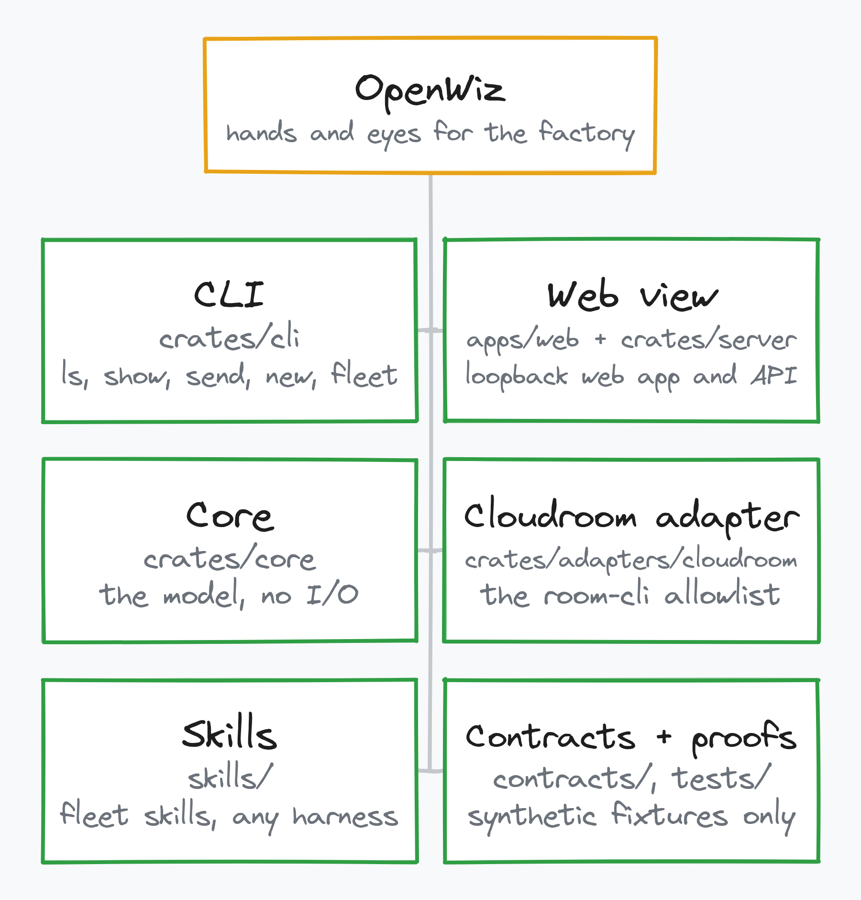

<h1 align="center">
  <picture>
    <source media="(prefers-color-scheme: dark)" srcset="docs/brand/openwiz-lockup-dark.svg">
    <source media="(prefers-color-scheme: light)" srcset="docs/brand/openwiz-lockup-light.svg">
    
  </picture>
</h1>

OpenWiz runs coding agents in fleets, with the user approving plans and OpenWiz building, reviewing and merging their tickets. It also provides a terminal and loopback web interface for CloudRoom sessions, messaging, new threads and attachments. See [STATUS.md](STATUS.md) for the distinction between published features, fixture-tested work and live acceptance.

Development targets the public repository [openwizdev/OpenWiz](https://github.com/openwizdev/OpenWiz). ClosedWiz stays private and keeps exact decision words, grills, live evidence, machine details and orchestration state. Public decisions give the decision, date and a private-record comment pointer, under the [open development contract](contracts/open-development.v1.md).

**Migration status:** development happens here, in `openwizdev/OpenWiz`. Private records are kept separately. Older issue and pull request links remain provenance for work completed before the move.

## Map

<picture>
  <source media="(max-width: 600px)" srcset="docs/map-phone.png">
  
</picture>

OpenWiz is the factory's hands (the CLI) and part of its eyes (the web view). The [org map](https://github.com/openwizdev) shows how it fits with the other repos.

## Install

Paste this line into your coding agent:

> Install OpenWiz from github.com/openwizdev/OpenWiz

Agents: read [`skills/install/SKILL.md`](skills/install/SKILL.md) and follow it. It checks the machine and CloudRoom, installs the verified prebuilt release (no Rust or Node), opens setup, then hands the first fleet to the [`onboard`](skills/onboard/SKILL.md) skill. Nothing starts until the user approves a plan. People: see the [install guide](docs/install.md), including recovery and removal. OpenWiz is free now. Paid plans come later. CloudRoom and model charges are separate and not included.

## Layout

| Path | What it is |
| --- | --- |
| `crates/` | Rust model, adapters, storage, CLI, loopback server, service and terminal app |
| `apps/web/` | Static web app over the loopback HTTP API |
| `apps/site/` | Landing page and version changelog |
| `contracts/` | Versioned contracts and JSON schemas |
| [`tests/`](tests/fixtures/README.md) | Proof suites, synthetic fixtures and fake external programs |
| [`skills/`](skills/README.md) | Fleet skills, installable across harnesses |
| `docs/agents/` | Project settings for fleets, helpers and triage |
| `docs/adr/` | Public decision summaries |
| [`release/openwiz/`](release/openwiz/README.md) | Frozen 0.0.0 product documentation; it is not the current release source |
| [`AGENTS.md`](AGENTS.md) | Agent rules, implementation map and commands |

## Development rules

- Public work and merges belong on OpenWiz. Private records stay in ClosedWiz; its history, issues and pull requests are never rewritten, deleted or published.
- Fixtures are synthetic. No credentials, live session content, personal identifiers, thread ids or exact decision words enter public records.
- CI, including the privacy check, and review of the exact head are required. On OpenWiz the merge queue checks the base; no self-hosted runner is registered, and every outside contributor's fork pull request needs approval before CI.
- Publishing, tagging, releases and live work retain their approval gates. Never force-push.

The [fleet settings](docs/agents/fleet.md) define agent pairs, scoped local checks, the required public ruleset and merge procedure. No repository named OpenWiz is ever made again under `jparker2006`, so the old addresses keep redirecting after the move.
